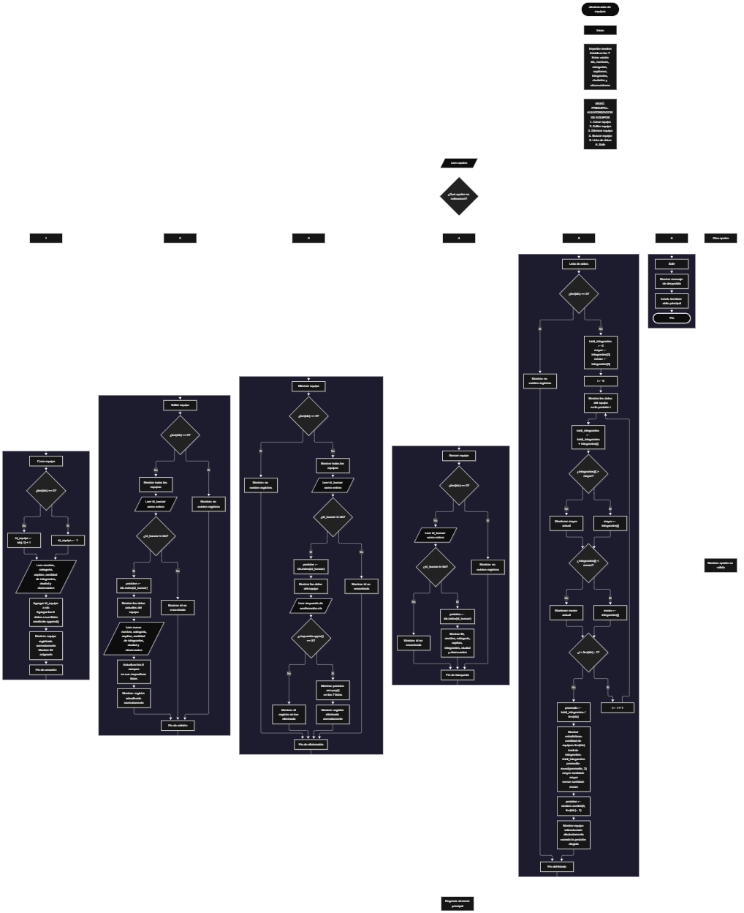

 

Este proyecto, llamado <b>aleatorizador de equipos</b>, fue desarrollado en <b>python</b> como un ejercicio práctico para fortalecer la lógica de programación mediante la creación de un sistema de gestión de equipos desde la consola. El programa cuenta con un menú principal de seis opciones que permite <b>crear, editar, eliminar, buscar, listar y seleccionar aleatoriamente</b> equipos registrados. Cada equipo almacena datos como el nombre, la categoría, el capitán, la cantidad de integrantes, la ciudad y las observaciones. La información se organiza mediante siete listas paralelas que mantienen relacionados los datos de cada registro durante la ejecución. Durante su desarrollo se aplicaron conceptos fundamentales de programación, como variables, listas, estructuras condicionales, ciclos repetitivos, operaciones con listas, cálculos estadísticos y selección aleatoria mediante el módulo <b>random</b>. Este proyecto permite poner en práctica los conocimientos adquiridos en Python y sirve como base para desarrollar sistemas de gestión más avanzados utilizando otros lenguajes y tecnologías.

<h2 align="center">⚙️ Funcionamiento del menú principal</h2>

### ➕ Crear equipo

La opción <b>1) crear equipo</b> permite registrar un nuevo equipo en el sistema. Antes de realizar el registro, el programa comprueba si la lista <b>ids</b> está vacía mediante la condición <b>len(ids) == 0</b>. Si no existen registros, asigna el identificador <b>1</b> a la variable <b>id_equipo</b>. En caso contrario, obtiene el último identificador almacenado y le suma uno mediante la expresión <b>ids[-1] + 1</b>. Después, solicita el <b>nombre del equipo, categoría, capitán, cantidad de integrantes, ciudad y observación</b>. La cantidad de integrantes se convierte a un número entero mediante <b>int()</b>. Una vez introducidos los datos, el programa utiliza <b>append()</b> para agregarlos a sus respectivas listas: <b>ids, nombres, categorias, capitanes, integrantes, ciudades y observaciones</b>. Finalmente, muestra el mensaje <b>"equipo registrado correctamente."</b> y presenta el identificador asignado al nuevo equipo.

### ✏️ Editar equipo

La opción <b>2) editar equipo</b> permite modificar los datos de un equipo registrado. Primero, el programa comprueba si existen registros mediante la condición <b>len(ids) == 0</b>. Si no hay equipos almacenados, muestra el mensaje <b>"no existen registros."</b>. En caso contrario, utiliza un ciclo <b>for</b> para recorrer las listas y presentar los datos de todos los equipos. Después, solicita el identificador del registro que se desea editar y convierte el valor introducido a un entero. Mediante la condición <b>id_buscar in ids</b>, comprueba si el identificador existe. Si lo encuentra, utiliza <b>ids.index(id_buscar)</b> para obtener la posición correspondiente y muestra los datos actuales del equipo. A continuación, solicita los nuevos valores para el nombre, la categoría, el capitán, la cantidad de integrantes, la ciudad y la observación, actualizando directamente las posiciones correspondientes de las listas. Finalmente, presenta el mensaje <b>"registro actualizado correctamente."</b>. Si el identificador no existe, muestra el mensaje <b>"id no encontrada."</b>. El identificador original permanece sin cambios.

### 🗑️ Eliminar equipo

La opción <b>3) eliminar equipo</b> permite eliminar un registro mediante su identificador. Antes de comenzar, el programa comprueba si existen equipos almacenados. Si las listas están vacías, muestra el mensaje <b>"no existen registros."</b>. Si hay equipos disponibles, recorre las listas y muestra sus datos. Después, solicita el identificador que se desea eliminar y comprueba si existe dentro de <b>ids</b>. Cuando encuentra una coincidencia, obtiene la posición mediante <b>ids.index(id_buscar)</b> y muestra los datos del equipo seleccionado. Posteriormente, solicita confirmación mediante la pregunta <b>"¿desea eliminar este registro? (s/n): "</b>. Si la respuesta, convertida a mayúsculas mediante <b>respuesta.upper()</b>, es igual a <b>"S"</b>, el programa utiliza <b>pop(posicion)</b> en las siete listas para eliminar los datos correspondientes al equipo. Finalmente, muestra el mensaje <b>"registro eliminado correctamente."</b>. Si el usuario no confirma la operación, presenta el mensaje <b>"el registro no fue eliminado."</b>. Si el identificador introducido no existe, muestra <b>"id no encontrada."</b>.

### 🔎 Buscar equipo

La opción <b>4) buscar equipo</b> permite localizar un equipo mediante su identificador. Primero, el programa comprueba si existen registros. Si no hay equipos almacenados, muestra el mensaje <b>"no existen registros."</b>. En caso contrario, solicita el identificador que se desea buscar y lo convierte a un número entero. A continuación, utiliza la condición <b>id_buscar in ids</b> para comprobar si el identificador está registrado. Si existe, obtiene la posición correspondiente mediante <b>ids.index(id_buscar)</b> y muestra todos los datos asociados al equipo: identificador, nombre, categoría, capitán, cantidad de integrantes, ciudad y observación. Si el identificador no aparece en la lista, presenta el mensaje <b>"id no encontrada."</b>. Esta función permite consultar un registro específico sin necesidad de revisar manualmente todos los equipos.

### 📋 Lista de datos

La opción <b>5) lista de datos</b> permite visualizar todos los equipos registrados y consultar estadísticas relacionadas con sus integrantes. Primero, el programa comprueba si existen registros. Si las listas están vacías, muestra el mensaje <b>"no existen registros."</b>. Si hay equipos almacenados, inicializa la variable <b>total_integrantes</b> en cero y establece las variables <b>mayor</b> y <b>menor</b> con el primer valor de la lista <b>integrantes</b>. Después, utiliza un ciclo <b>for</b> para recorrer todos los registros, mostrar los datos de cada equipo y acumular la cantidad de integrantes mediante la operación <b>total_integrantes += integrantes[i]</b>. Durante el recorrido, compara la cantidad de integrantes de cada equipo con los valores de <b>mayor</b> y <b>menor</b>, actualizándolos cuando encuentra una cantidad superior o inferior, respectivamente. Al finalizar, calcula el promedio mediante <b>total_integrantes / len(ids)</b> y utiliza <b>round(promedio, 2)</b> para mostrarlo con dos decimales. Posteriormente, presenta la cantidad de equipos, el total de integrantes, el promedio, la mayor cantidad y la menor cantidad de integrantes. Finalmente, utiliza <b>random.randint(0, len(ids) - 1)</b> para seleccionar una posición aleatoria y muestra los datos del equipo correspondiente. Esta opción reúne el listado general, los cálculos estadísticos y la selección aleatoria de un equipo existente.

### 🚪 Salir del menú principal

La opción <b>6) salir</b> permite finalizar la ejecución del programa. Cuando el usuario selecciona esta opción, el sistema muestra el mensaje <b>"gracias por utilizar el aleatorizador de equipos."</b> y ejecuta la instrucción <b>break</b>, que interrumpe el ciclo principal <b>while True</b>. De esta manera, el menú deja de repetirse y el programa termina su ejecución. Si el usuario introduce un valor que no corresponde a ninguna de las seis opciones disponibles, la estructura condicional muestra el mensaje <b>"opción no válida."</b> y el menú continúa activo.

<h2 align="center">🧠 Temas aplicados en el proyecto</h2>

### 📦 Variables

En este proyecto se utilizan variables para controlar el menú, asignar identificadores, recibir los datos de cada equipo, localizar registros y realizar cálculos estadísticos. También se emplean variables auxiliares para almacenar la posición de un registro, confirmar su eliminación, acumular la cantidad de integrantes y determinar los valores máximo y mínimo. Cada variable cumple una función específica dentro de las operaciones de gestión y consulta de la información.

🔢 **Opcion:** Almacena la opción seleccionada por el usuario en el menú principal.

🆔 **Id_equipo:** Almacena el identificador asignado al nuevo equipo.

🔎 **Id_buscar:** Guarda el identificador que se desea localizar, editar o eliminar.

📍 **Posicion:** Indica el índice de las listas correspondiente al equipo seleccionado o elegido aleatoriamente.

🧮 **Cantidad:** La cantidad de integrantes se recibe directamente mediante la entrada de datos y se convierte a entero antes de almacenarse.

📊 **Total_integrantes:** Acumula la cantidad de integrantes de todos los equipos registrados.

📈 **Promedio:** Almacena el promedio de integrantes por equipo.

⬆️ **Mayor:** Guarda la mayor cantidad de integrantes encontrada durante el recorrido.

⬇️ **Menor:** Guarda la menor cantidad de integrantes encontrada durante el recorrido.

🔄 **I:** Funciona como contador del ciclo que recorre los registros.

✅ **Respuesta:** Almacena la confirmación del usuario antes de eliminar un equipo.

### 🗃️ Listas

El programa utiliza siete listas paralelas para almacenar la información de los equipos. Cada lista contiene un tipo de dato relacionado con los registros y utiliza la misma posición para mantener vinculados los datos de un mismo equipo. Por ejemplo, la información del primer equipo se encuentra en las posiciones correspondientes de <b>ids, nombres, categorias, capitanes, integrantes, ciudades y observaciones</b>. Esta organización permite recorrer, buscar, modificar, mostrar y eliminar registros de manera coordinada. Las listas no tienen una capacidad máxima definida en el código y almacenan los registros únicamente durante la ejecución del programa.

🆔 **Ids:** Almacena los identificadores de los equipos registrados.

📝 **Nombres:** Almacena los nombres de los equipos.

🏷️ **Categorias:** Almacena las categorías de los equipos.

👤 **Capitanes:** Almacena los nombres de los capitanes.

👥 **Integrantes:** Almacena la cantidad de integrantes de cada equipo como un número entero.

🌆 **Ciudades:** Almacena las ciudades asociadas a los equipos.

📄 **Observaciones:** Almacena las observaciones adicionales de cada equipo.

### 🔀 Estructuras condicionales

En este proyecto se utilizan las estructuras <b>if, elif y else</b> para seleccionar las operaciones del menú, comprobar si existen registros antes de realizar determinadas acciones, verificar si un identificador está registrado y decidir si se debe confirmar una eliminación. También se emplean condiciones para comparar la cantidad de integrantes de cada equipo y actualizar los valores de <b>mayor</b> y <b>menor</b>. Estas estructuras permiten que el programa ejecute diferentes instrucciones según los datos introducidos y el estado actual de los registros.

### 🔄 Estructuras repetitivas

El programa utiliza los ciclos <b>while</b> y <b>for</b>. El ciclo <b>while True</b> mantiene activo el menú principal hasta que el usuario selecciona la opción de salida y se ejecuta <b>break</b>. Por otro lado, los ciclos <b>for</b> permiten recorrer las listas para mostrar los equipos registrados durante las operaciones de edición y eliminación, así como calcular estadísticas y presentar todos los datos en la opción de listado. Estos ciclos facilitan la gestión de múltiples registros sin tener que escribir instrucciones individuales para cada equipo.

### 🎯 Estructuras de selección

La selección de operaciones se realiza mediante una cadena de condiciones <b>if, elif y else</b> que evalúa la variable <b>opcion</b>. Cada condición corresponde a una función específica del sistema: <b>crear equipo, editar equipo, eliminar equipo, buscar equipo, lista de datos o salir</b>. Si el valor introducido no coincide con ninguna de las opciones definidas, se ejecuta el bloque <b>else</b> y se muestra el mensaje <b>"opción no válida."</b>. Esta organización permite centralizar las operaciones disponibles en un único menú principal.

### 🔢 Operaciones con listas

El proyecto utiliza diferentes operaciones para administrar los registros. La función <b>append()</b> agrega los datos de un nuevo equipo al final de las listas. El método <b>pop(posicion)</b> elimina los datos de un equipo en la posición seleccionada. La función <b>len()</b> permite comprobar si existen registros, conocer la cantidad de equipos y calcular el promedio de integrantes. El método <b>index()</b> obtiene la posición de un identificador encontrado y la expresión <b>ids[-1]</b> permite consultar el último identificador almacenado. Estas operaciones facilitan la administración de las listas paralelas.

### 🎲 Módulo random

El módulo <b>random</b> se importa al inicio del programa mediante la instrucción <b>import random</b>. Se utiliza en la opción de lista de datos para seleccionar aleatoriamente uno de los equipos registrados. La función <b>random.randint(0, len(ids) - 1)</b> genera un número entero dentro del rango de índices disponibles. El valor obtenido se almacena en la variable <b>posicion</b> y permite mostrar los datos del equipo seleccionado. Esta operación no crea equipos nuevos ni genera integrantes aleatorios; únicamente selecciona un registro existente.

### 🧮 Cálculos estadísticos

El programa realiza cálculos estadísticos sobre la cantidad de integrantes de los equipos. La variable <b>total_integrantes</b> acumula los valores de la lista <b>integrantes</b>. Las variables <b>mayor</b> y <b>menor</b> permiten identificar la cantidad más alta y la más baja de integrantes, respectivamente. La variable <b>promedio</b> almacena el resultado de dividir el total de integrantes entre el número de equipos registrados. Para presentar el promedio con dos decimales se utiliza la función <b>round()</b>. Estos cálculos ofrecen una visión general de la distribución de integrantes entre los equipos registrados.

<h2 align="center">¿Cómo se implementaron las operaciones crud en el proyecto?</h2>

Las operaciones <b>crud</b> se implementaron mediante las opciones del menú principal, permitiendo administrar los equipos registrados. La operación <b>crear</b> corresponde a <b>crear equipo</b>, donde se introducen los datos de un nuevo registro; <b>leer</b> se realiza mediante las opciones <b>buscar equipo y lista de datos</b>, que permiten consultar un registro específico o visualizar todos los equipos; <b>actualizar</b> corresponde a <b>editar equipo</b>, donde se modifican los datos de un equipo existente; y <b>eliminar</b> se realiza mediante la opción <b>eliminar equipo</b>, que permite retirar un registro después de confirmar la operación. Estas funciones utilizan listas, variables, estructuras condicionales y ciclos para administrar la información almacenada temporalmente durante la ejecución del programa. La selección aleatoria y las estadísticas complementan las operaciones de gestión, pero no sustituyen las operaciones crud.

<h2 align="center">Diagrama de flujo del proyecto</h2>

<h2 align="center">🛡️ Validaciones del programa</h2>

### 📭 No existen registros

Esta comprobación se utiliza en las opciones de <b>editar, eliminar, buscar y lista de datos</b>. El programa evalúa la condición <b>len(ids) == 0</b> para determinar si hay equipos almacenados. Si la lista está vacía, muestra el mensaje <b>"no existen registros."</b> y evita continuar con las operaciones que necesitan información existente. En la opción de listado, esta comprobación también evita acceder a <b>integrantes[0]</b> o intentar seleccionar una posición aleatoria cuando no hay equipos registrados.

### 🔎 Identificador no encontrado

Esta comprobación se utiliza en las operaciones de <b>editar, eliminar y buscar equipo</b>. El programa evalúa la condición <b>id_buscar in ids</b> para verificar si el identificador introducido existe en la lista. Si encuentra el registro, obtiene su posición mediante <b>ids.index(id_buscar)</b> y ejecuta la operación correspondiente. Si no existe, muestra el mensaje <b>"id no encontrada."</b>. Esta comprobación permite evitar que las operaciones continúen con un identificador que no está registrado.

### 🗑️ Confirmación de eliminación

Antes de eliminar un equipo, el programa solicita confirmación mediante una entrada de texto. La condición <b>respuesta.upper() == "S"</b> permite aceptar tanto la letra <b>s</b> como la letra <b>S</b>. Si se confirma la operación, el programa elimina el registro de las siete listas utilizando la misma posición. Si la respuesta no es afirmativa, muestra el mensaje <b>"el registro no fue eliminado."</b>. El código actual interpreta cualquier respuesta diferente de <b>s</b> o <b>S</b> como una cancelación, sin solicitar una confirmación adicional.

### 🔢 Conversión de datos numéricos

El programa utiliza <b>int()</b> para convertir la cantidad de integrantes y los identificadores introducidos por el usuario a números enteros. Esto permite almacenar la cantidad de integrantes como un valor numérico y realizar los cálculos estadísticos correspondientes. Sin embargo, el código actual no controla los errores de conversión: si se introduce texto u otro valor que no pueda convertirse a entero, Python puede generar una excepción y detener la ejecución.

### ⚠️ Opción inválida

La estructura condicional del menú incluye un bloque <b>else</b> que se ejecuta cuando el valor de <b>opcion</b> no coincide con ninguna de las seis opciones disponibles. En ese caso, el programa muestra el mensaje <b>"opción no válida."</b> y vuelve a presentar el menú principal. Esta comprobación permite continuar utilizando el sistema cuando se introduce una opción diferente de las admitidas.

### 📝 Límites de las validaciones

El código actual comprueba la existencia de registros y de identificadores, pero no valida todos los datos introducidos. Por ejemplo, no comprueba que la cantidad de integrantes sea positiva, que los campos de texto contengan información válida ni que las respuestas de confirmación se limiten a las opciones <b>s</b> y <b>n</b>. Tampoco incorpora almacenamiento permanente en archivos o bases de datos. Por ello, los datos permanecen disponibles únicamente mientras el programa está en ejecución y se pierden al finalizarlo.

<h2 align="center">🎯 Objetivo del proyecto</h2>

El objetivo principal de este proyecto es fortalecer la <b>lógica de programación</b> mediante el desarrollo de un sistema de gestión de equipos en <b>python</b>. A través de su construcción se busca aplicar los conocimientos adquiridos sobre variables, listas, estructuras condicionales, ciclos repetitivos, operaciones con listas, cálculos estadísticos y selección aleatoria. Además, el proyecto permite comprender cómo registrar, consultar, modificar y eliminar información en una aplicación de consola, así como obtener estadísticas básicas a partir de los datos almacenados. De esta manera, constituye una base para desarrollar sistemas de gestión más completos utilizando otros lenguajes y tecnologías.

